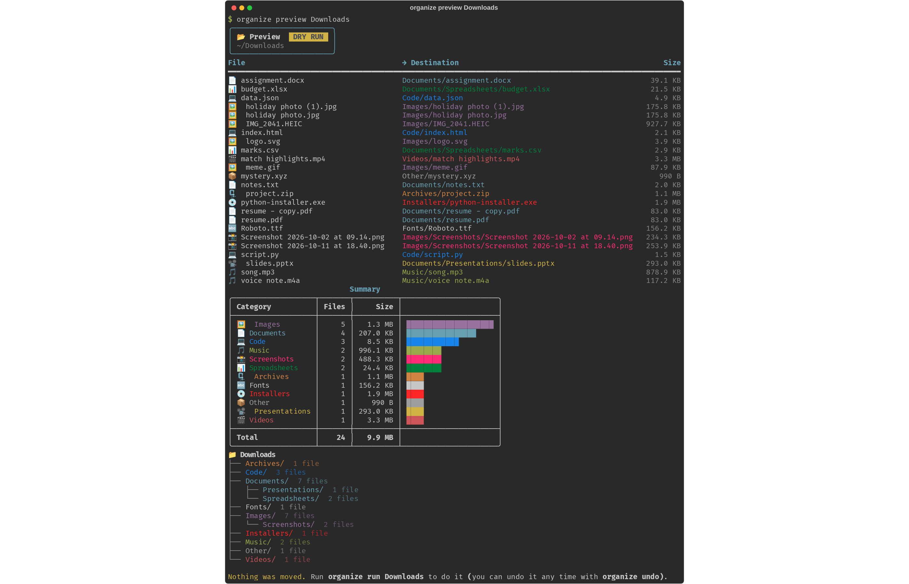
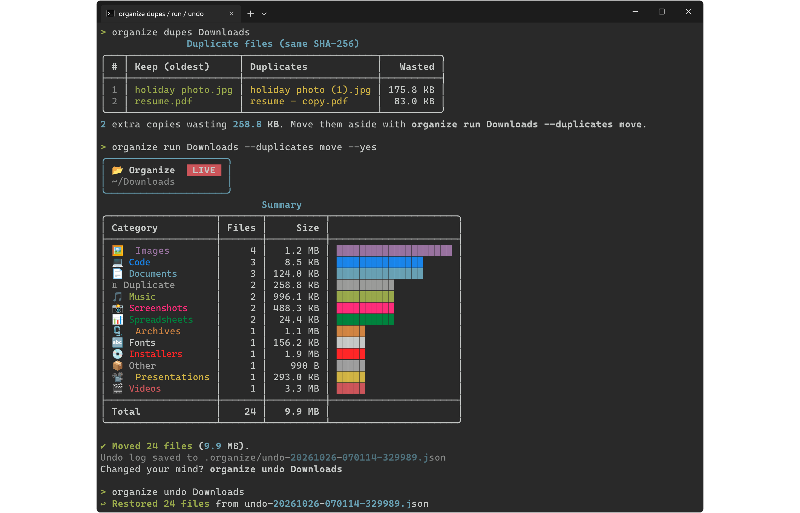

# 🗂️ Smart File Organizer

[](https://github.com/abhinaba-chanda/smart-file-organizer/releases/latest)
[](https://github.com/abhinaba-chanda/smart-file-organizer/actions/workflows/ci.yml)


[](LICENSE)

**Turn a messy Downloads folder into a tidy one with one command: sort by type and/or date, preview first, undo any time, and catch duplicate files.**



## ✨ Features

- **Dry-run preview** – see every move, a summary per category and the final folder tree before anything changes.
- **Undo log** – every run writes `.organize/undo-*.json`; `organize undo` puts every file back and removes the empty folders it created.
- **Duplicate detection** – finds identical files by content (size → first 64 KB → full SHA-256, so it stays fast) and can move the extra copies into a `Duplicates` folder.
- **Rules from YAML** – match by extension, file-name pattern (`Screenshot*`) or size (`min_size: 1GB`); first matching rule wins.
- **Three layouts** – `type` (`Images/…`), `date` (`2026/10/…`) or `type-date` (`Images/2026/10/…`).
- **Safe by design** – never overwrites (name clashes become `photo (1).jpg`), skips hidden files and half-finished downloads (`*.crdownload`, `*.part`), and asks before moving.
- **Colourful terminal UI** made with [rich](https://github.com/Textualize/rich): tables, a tree view and a progress bar.
- **Cross-platform** – uses `pathlib` throughout, stores portable paths in the undo log, and the CI runs on **Windows, macOS and Linux** with Python 3.9 and 3.12.



## 🪟 Download for Windows

No Python needed: grab the ready-made **[SmartFileOrganizer.exe from the latest release](https://github.com/abhinaba-chanda/smart-file-organizer/releases/latest)** and double-click it. It opens in guided mode: pick *organize*, drag your folder into the window (or press Enter for Downloads), check the preview, then confirm. You can also run it from cmd or PowerShell with the same arguments as `organize`, e.g. `SmartFileOrganizer.exe preview "C:\Users\you\Downloads"`.

The exe is built from this source by GitHub Actions ([release workflow](.github/workflows/release.yml)) and is not code-signed, so Windows SmartScreen may warn you: click **More info → Run anyway**. Each release lists the exe's SHA-256 checksum.

## 🚀 Quick start

```bash
git clone https://github.com/abhinaba-chanda/smart-file-organizer.git
cd smart-file-organizer
pip install .
```

This gives you the `organize` command. Then:

```bash
organize preview ~/Downloads        # look first, changes nothing
organize run ~/Downloads            # do it (asks to confirm)
organize undo ~/Downloads           # changed your mind? put everything back
```

On Windows the same commands work in PowerShell or cmd:

```powershell
organize preview "$HOME\Downloads"
organize run "C:\Users\you\Downloads" --mode type-date
```

Want to try it on fake files first?

```bash
python examples/make_messy_folder.py demo-downloads
organize preview demo-downloads
```

## 🧪 Usage examples

| Command | What it does |
|---|---|
| `organize preview FOLDER` | Dry run: table of moves, summary and folder tree |
| `organize preview FOLDER --all` | List every planned move, not just the first 25 |
| `organize run FOLDER --yes` | Organize without asking |
| `organize run FOLDER --dry-run` | Same as `preview` |
| `organize run FOLDER --mode date` | Sort into `YEAR/MONTH` folders |
| `organize run FOLDER --dest D:\Sorted` | Put sorted files somewhere else |
| `organize run FOLDER --recursive` | Also pick up files inside sub-folders |
| `organize run FOLDER --duplicates move` | Move extra copies to `Duplicates/` |
| `organize dupes FOLDER` | Just list duplicate files and the space they waste |
| `organize undo FOLDER` | Undo the latest run (run it again to undo the one before) |
| `organize undo FOLDER --list` | Show the available undo logs |
| `organize init-config FOLDER` | Write `organizer.yaml` with the default rules to edit |

If the `organize` script is not on your PATH, run the package as a module instead:

```bash
python3 -m smart_organizer preview FOLDER
```

## ⚙️ Custom rules (YAML)

`organize init-config ~/Downloads` writes the [default rules](src/smart_organizer/default_config.yaml) to `~/Downloads/organizer.yaml`. If that file exists, it is used automatically; or pass any file with `--config`.

```yaml
mode: type-date              # type | date | type-date
date_format: "{year}/{month:02d}"
other_folder: Other
duplicates: move             # keep | move
ignore: ["*.crdownload", "*.part"]

rules:                       # first match wins
  - name: Football
    folder: Football/Barca
    patterns: ["*barca*", "*messi*"]
  - name: College
    folder: Documents/College
    patterns: ["*assignment*", "*notes*"]
    extensions: [pdf, docx]
  - name: Images
    folder: Images
    extensions: [jpg, jpeg, png, gif, webp, heic]
  - name: Huge
    folder: Big files
    min_size: 500MB
```

Mistakes in the file (an unknown mode, a missing `folder`, a folder that points outside with `..`) are reported clearly instead of moving files to strange places.

## 🗂️ Project structure

```text
smart-file-organizer/
├── src/smart_organizer/
│   ├── cli.py                 # argparse commands: preview, run, undo, dupes, init-config
│   ├── config.py              # YAML loading + validation, rule matching
│   ├── planner.py             # decides where each file goes (touches nothing)
│   ├── executor.py            # moves files, writes and replays the undo log
│   ├── duplicates.py          # size -> partial hash -> SHA-256 duplicate finder
│   ├── ui.py                  # rich tables, tree and colours
│   └── default_config.yaml    # built-in rules
├── examples/make_messy_folder.py
├── tests/                     # pytest (planner, executor/undo, duplicates, config, CLI)
├── docs/                      # terminal screenshots
├── pyproject.toml             # `pip install .` -> `organize`
└── .github/workflows/ci.yml   # tests on Windows, macOS, Linux
```

## 🧑‍💻 Development

```bash
pip install -e ".[dev]"
pytest -q
```

The screenshots above are real runs on the demo folder, exported with rich's SVG export and converted to PNG.

## 📄 License

[MIT](LICENSE) © 2026 Abhinaba Chanda
